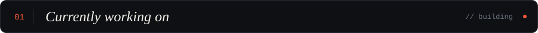
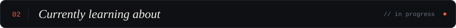
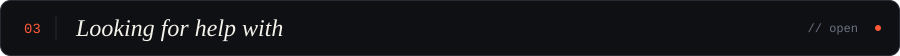
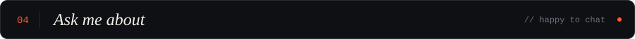
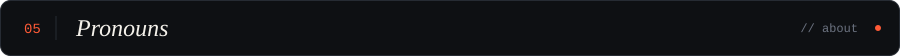
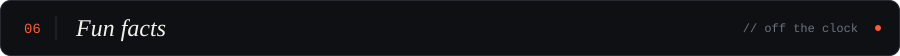

 

 

- Building a strong open-source foundation
- Making consistent and meaningful GitHub contributions

- Artificial Intelligence & Machine Learning
- Git, GitHub, and open-source workflows
- Data Structures & Algorithms (DSA)
- JavaScript
- Python libraries

- Learning Python
- Understanding real-world open-source standards

- Getting started with open source
- GitHub basics and contribution workflows

- He / Him

- Plays chess
- Solves a Rubik's Cube in under a minute
- Learning Japanese as a fourth language
